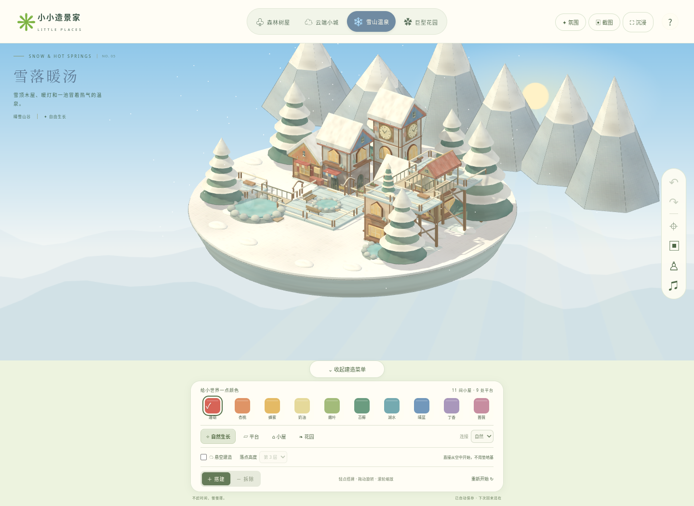
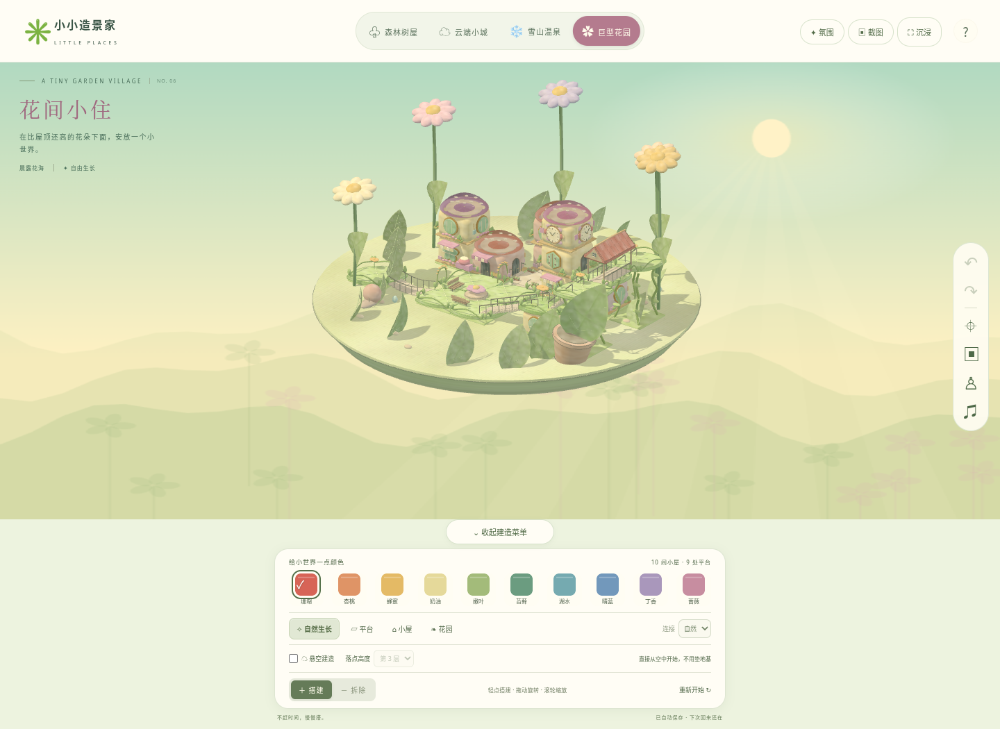
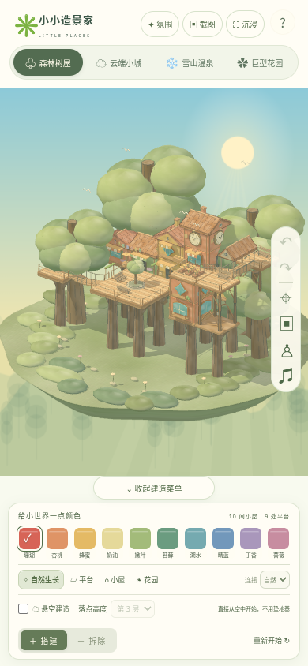

# 小小造景家 · 四个手绘立体小世界

点击搭建、自动连接的网页版自由造景游戏。以手绘微缩建筑为美术方向：细描边、斑驳墙面、暖色瓦片、花箱、百叶窗与悬挂小桥。没有任务、付费项目或倒计时。

## 四个独立场景

- **森间来信 · 森林树屋村**：树干托起木平台，树冠、林地小花、萤光与吊桥环绕小村庄。独立网页：[forest-village.html](forest-village.html)。
- **云上的日子 · 云端天空城**：彩色房屋、悬浮岩岛、垂藤与慢慢漂移的云朵。独立网页：[sky-city.html](sky-city.html)。

- **雪落暖汤 · 雪山温泉村**：积雪山峰、雪松、温泉与缓缓升起的蒸汽，搭配陡顶木屋。独立网页：[snow-village.html](snow-village.html)。
- **花间小住 · 巨型花园迷你村**：巨型花朵、叶片、露珠与蘑菇小屋。独立网页：[garden-village.html](garden-village.html)。

四个文件都包含完整引擎、模型、纹理和界面。下载后用支持 WebGL 的 Chrome、Edge 或 Safari 打开即可，不需要安装游戏或联网加载素材。页面顶部也能随时切换场景；四个世界分别存档。旧作品会保留并兼容新玩法；如需查看新的平台与桥梁示范布局，可使用「重新开始」（支持撤销）。下载 GitHub 文件时请用文件页的下载按钮，代码页面本身不是游戏页面。





## 怎么玩

1. 在底部选一种颜色。
2. 默认「自然生长」：点击空地先铺平台，再点变小屋，继续点形成屋顶露台。也可直接选「平台」「小屋」「花园」。每块地最多六层。
3. 平台并排连成广场，四块同高平台形成带座椅、绿植或喷泉的庭院；花园有花架、花箱与垂藤。高处墙面可以向外延伸架空平台，自动生成支撑。
4. 同高地块连接步道，相差一层的平台生成楼梯；跨越空隙时根据主题、跨度生成吊桥、拱桥或廊桥，也可在「连接」中选择新地块的桥型。同高桥梁交叉时自动形成小平台。接入房屋的连接会生成门廊，入口栏杆留出缺口。
5. 打开「悬空建造」，选择第几层，再点空白处，可直接在空中放置房屋、平台或花园，不生成下方地基和支柱。关闭后恢复正常落地搭建。
6. 拖动旋转镜头，滚轮缩放；手机单指旋转、双指缩放和平移。
7. 切换「拆除」后点击建筑，逐层删除；桌面也支持右键点击拆除。撤销、重做按钮随时可用，快捷键为 Ctrl/Cmd+Z、Ctrl/Cmd+Shift+Z。
8. 点击右侧相框保存作品 PNG。「重新开始」需要确认，并且可以撤销。

选择「小屋」工具连续叠加：两层成为 loft，三层钟楼，四层书屋，五层观星塔，六层风铃塔；平台或花园会分隔连续的房屋。四个场景分别采用木构、圆顶、积雪山屋和蘑菇屋外观。

右上角「沉浸」隐藏界面，再点可恢复。底部「收起建造菜单」在手机和电脑都可用；键盘 I 切换沉浸、M 收放菜单、Esc 退出沉浸。手机界面将菜单放在画面下方，移除全屏渐变和场景雾，保持明亮。

作品自动保存于当前浏览器；不跨设备同步。每个世界最多 180 个地块。浏览器若禁用存储，会在页面下方提示。

## 开发与构建

需要 Node.js 22+（推荐 24）和 npm。

```sh
npm ci
npm run dev
```

默认监听 `0.0.0.0:3000`。开发首页是造景游戏，`?scene=sky`、`?scene=snow`、`?scene=garden` 可直接打开对应场景。源代码版本需要 HTTP 服务，独立构建文件可以直接打开。

```sh
npm test
npm run build
```

构建生成仓库根目录的 `forest-village.html`、`sky-city.html`、`snow-village.html`、`garden-village.html`，以及可部署的 `dist/`。`dist/index.html` 默认进入森林场景，天空城为 `dist/sky-city.html`。场景、纹理和音乐由代码生成，截图组件也打包在网页内，没有外部运行资源请求。

64 项自动测试覆盖造景的建造、颜色分层、拆除、撤销重做、邻接、存档兼容、平台与花园转换、架空支撑、同高庭院、桥型、高差楼梯和交汇平台，悬空建筑及交汇平台的保存、撤销与拆除，实例显示资源的复用与删除，连续房屋形态演化与四个主题的布局和保存，平台和花园的六层演化、横向组合、居民路线和氛围设置校验，以及原仓鼠游戏的物理测试。浏览器另行检查真实点击建造、转动镜头、独立存档、重载、PNG 下载和四个独立网页的离线手机布局、沉浸模式和菜单收放。

建造使用局部更新：复用未改变的建筑、邻居、桥梁和庭院，缓存几何体，并通过持久 GPU 实例缓冲更新位置；不再每次复制、合并整座小镇。阴影只在场景变更时更新。保留独立拾取对象，确保点击与悬停准确。

## 文件

- `src/town/model.js`：独立场景数据、建造规则、历史与存档校验。
- `src/town/instances.js`：持久实例显示、动态扩容、删除与槽位复用。
- `src/town/architecture.js`：四种主题的建筑与叠加形态。
- `src/town/new-scenery.js`：雪山温泉和巨型花园环境。
- `src/town/view.js`：真实 3D 模型、手绘纹理、自动连接、场景与相机。
- `src/town/main.js`：鼠标/触屏操作、选色、存档、导出与界面。
- `src/town/style.css`：桌面与手机界面。
- `build.mjs`：将四款造景游戏和原仓鼠游戏打包为独立 HTML。

## 原仓鼠游戏

原游戏保留在 [hamster-3d.html](hamster-3d.html)，开发入口为 `hamster-source.html`，说明见 [HAMSTER.md](HAMSTER.md)。

## GitHub Pages

仓库已有自动构建工作流。拥有者需要在 Settings → Pages → Source 选择 GitHub Actions；部署成功后，工作流会给出网站地址。仓库里的 HTML 代码页面不是已上线的游戏网址。

## 组合发现与小居民

四个主题分别设计房屋、平台和花园；选择对应工具连续叠加，最多六层。花园在平台上会替换平台，再点花园会继续叠高。平台或花园会分隔房屋的连续楼层。房屋的总层数和所在楼层共同决定窗型、窗格、标牌、挂饰等细节。

| 场景 | 两层房屋 / 平台 / 花园 | 三层平台 / 花园 | 两个横向相邻的组合 |
| --- | --- | --- | --- |
| 森林 | 树影 Loft / 野餐凉亭 / 玻璃温室 | 树梢舞台 / 藤蔓瀑布园 | 面包铺、长桌野餐台、藤蔓花门 |
| 云端 | 拱廊复式 / 拱券茶亭 / 水晶花房 | 竖琴音乐台 / 星泉瀑布 | 双子拱门、云端茶席、云泉花桥 |
| 雪山 | 暖窗复式 / 暖汤歇脚亭 / 暖光温室 | 雪橇瞭望台 / 层叠暖汤 | 暖汤旅馆、雪橇驿站、暖汤双池 |
| 花园 | 花瓣复式 / 花瓣茶座 / 露珠花房 | 蜗牛音乐台 / 花瀑叠院 | 点心铺、叶上茶会、蝴蝶花门 |

三个横向相连会进一步变为街市、音乐台或花廊，四个及以上形成广场和院落。组合按建筑类型、实际楼层与上下左右邻接识别，拆除或撤销会重新计算。

点击右上「氛围」：每场景有三套独立远景，共 12 套。可叠加阳光、飘雪、细雨、飞鸟和小动物，并调节画面亮度。点「随机小居民」或右侧人形按钮，每次增加不同装扮与职业的居民，最多 10 位；他们沿已有步道、桥、楼梯行走，停下来读书、浇花、送信、画画或休息。拆除路线后会重新选择可站立的位置，不跨过断路。背景、效果和居民按场景分别保存。

音符按钮播放或暂停内置的原创轻钢琴与柔和长音；氛围面板可以调音量。浏览器要求点击后才能开始播放，切到后台会暂停，所有音乐在本地生成，不联网加载音频。

「截图」保存当前页面，包括当前视角、天气、居民和可见界面；沉浸模式可以拍更干净的画面。预览中可下载 PNG，手机也可长按预览图片保存。手机色块采用带颜色名称的独立 SVG 图像，页面声明仅使用浅色显示，并提供亮度调节。

新模块：`combinations.js` 组合规则，`structures.js` 主题平台和花园，`ambience.js` 背景与动态居民，`life-routes.js` 可行走路线，`music.js` 音乐，`settings-ui.js` 氛围设置，`screenshot.js` 页面截图。


